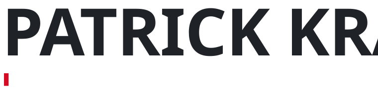
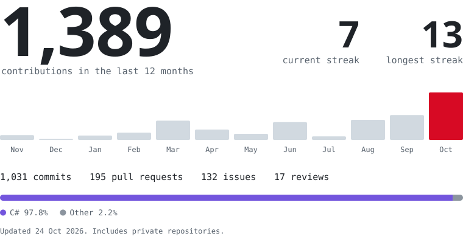

<picture>
  
</picture>

I'm Patrick, and I'm retraining as a Fachinformatiker für Anwendungsentwicklung (IHK) in Germany. Before that I spent two and a half years in pharmaceutical production, mostly in a GMP cleanroom, where every step is done exactly to spec and written down. I've brought that habit to code. Most days I'm working on a game in Unity or on something for the web.

## Projects

**Undercrown** is a low-poly medieval survival game in Unity and C#, built for multiplayer from day one. It's my main project right now and lives in a private repo, so the activity below counts private repositories too.

- **[Survive Tonight](https://berrybit.itch.io/survive-tonight)**: a short 2D horror prototype I made with a friend as BerryBit Studios for Scream Jam 2025. Playable on itch.io for Windows, macOS and Linux.
- **[Portfolio](https://github.com/HeyItsPATTE/portfolio-source)**: the source of my personal site, built with Nuxt 4, Vue 3, TypeScript and SCSS.

## Activity

<picture>
  <source media="(prefers-color-scheme: dark)" srcset="assets/stats-dark.svg">
  
</picture>

## Tools I work with

<picture>
  <source media="(prefers-color-scheme: dark)" srcset="https://skillicons.dev/icons?i=cs%2Cjava%2Cjs%2Cts%2Chtml%2Ccss%2Cvue%2Cnuxtjs%2Cunity%2Cmysql%2Cdocker%2Cgit%2Cidea&perline=13&theme=dark">
  
</picture>

## Get in touch

[LinkedIn](https://www.linkedin.com/in/patrick-kraft-8a1472393/) is the best place to reach me. On Discord I'm `heyitspatte`.
